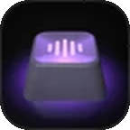
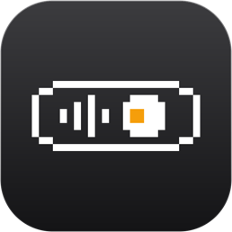
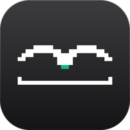

  <picture>
    <source media="(prefers-color-scheme: dark)" srcset="assets/hello-dark.svg">
    
  </picture>

Small, polished apps for macOS and the web. Built with AI, finished by hand.

<a href="https://khalidkhalil.dev"><b>khalidkhalil.dev</b></a>

 

### ▸ Apps

<table>
  <tr>
    <td width="110" align="center"></td>
    <td>
      <b>Thock</b> &nbsp;<code>macOS</code> <code>Free</code> <code>v1.2</code> 
      Mechanical keyboard sounds for your MacBook. It feels how hard you type through the motion sensor:
      16 sound packs, stereo by key position, and a boom when you slam Enter. 
      <a href="https://github.com/kakhaliel/Thock-Releases/releases/latest/download/Thock.dmg"><b>⬇ Download</b></a> &nbsp;·&nbsp; <a href="https://khalidkhalil.dev/apps/thock">Try it with sound</a> 
      macOS 13 or later · Swift · SwiftUI · Core Motion
    </td>
  </tr>
  <tr>
    <td width="110" align="center"></td>
    <td>
      <b>Overlook</b> &nbsp;<code>macOS</code> <code>Free</code> <code>v0.1.1</code> 
      Your MacBook notch, alive. Music controls, a timer, your calendar, clipboard history and a shelf for files,
      plus little pixel animations when you plug in the charger, connect AirPods or hit Caps Lock. 
      <a href="https://github.com/kakhaliel/Overlook-Releases/releases/latest/download/Overlook.dmg"><b>⬇ Download</b></a> &nbsp;·&nbsp; <a href="https://khalidkhalil.dev/apps/overlook">See what it does</a> 
      macOS 14 or later · Swift · SwiftUI
    </td>
  </tr>
  <tr>
    <td width="110" align="center"></td>
    <td>
      <b>Swoop</b> &nbsp;<code>macOS</code> <code>Free</code> <code>v0.6</code> 
      Downloads that swoop in, on every connection. Swoop splits each file across many connections at once,
      picks up where it left off after a restart, and saves videos and whole playlists from YouTube and most video sites. 
      <a href="https://github.com/kakhaliel/Swoop-Releases/releases/latest/download/Swoop.dmg"><b>⬇ Download</b></a> &nbsp;·&nbsp; <a href="https://khalidkhalil.dev/apps/swoop">Watch it swoop in</a> 
      macOS 14 or later · Swift · SwiftUI
    </td>
  </tr>
  <tr>
    <td width="110" align="center"><code>???</code></td>
    <td><b>Next app</b> In the works. Follow along.</td>
  </tr>
</table>

### ▸ Tools

  
  
  
  
  
  

 

 Vibe-coded with Claude ✦ press start

