  <picture>
    <source media="(prefers-color-scheme: dark)" srcset="assets/hello-dark.svg">
    
  </picture>

<h3 align="center">I make the apps I wish existed.</h3>

Small, polished apps for macOS and the web. Imagined by me, built fast with AI, finished by hand.

 

### ▸ Apps

<table>
  <tr>
    <td width="110" align="center"></td>
    <td>
      <b>Thock</b> &nbsp;<code>macOS</code> <code>Free</code> <code>v1.0</code> 
      Mechanical keyboard sounds for your MacBook. It feels how hard you type through the motion sensor:
      16 sound packs, stereo by key position, and a boom when you slam Enter. 
      macOS 13 or later · Swift · SwiftUI · Core Motion
    </td>
  </tr>
  <tr>
    <td width="110" align="center"><code>???</code></td>
    <td><b>Next app</b> In the works. Follow along.</td>
  </tr>
</table>

### ▸ Tools

  
  
  
  
  
  

 

 Vibe-coded with Claude ✦ press start

